# UI compare: live page vs prototype (360 px)

Generated by `scripts/ui_screens.py` (live page served with fake services; the prototype shows its own
simulated data). Only the phone screen element (`#screen`) is captured on both sides.

| Screen | Prototype | Live (web/index.html) |
|---|---|---|
| Language | 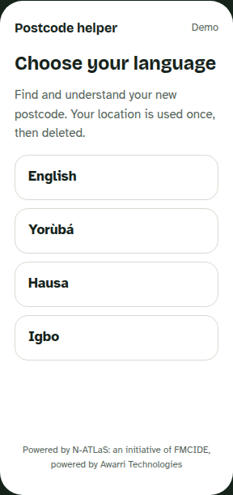 | 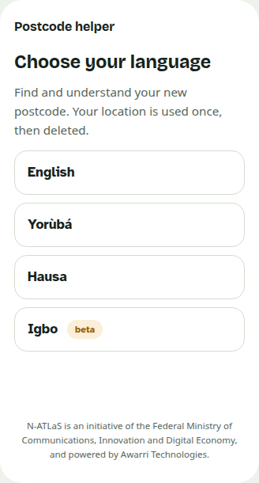 |
| Welcome and consent (new, prototype parts) | — | 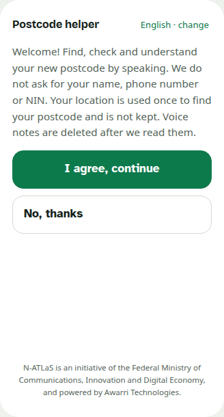 |
| Did you know your postcode? (new, prototype parts) | — | 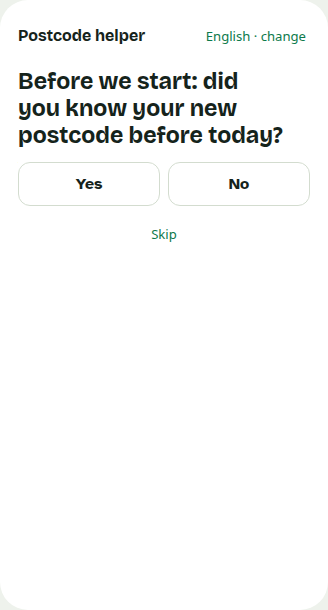 |
| Home | 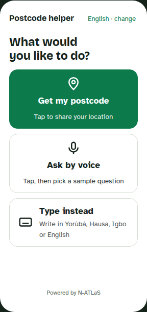 | 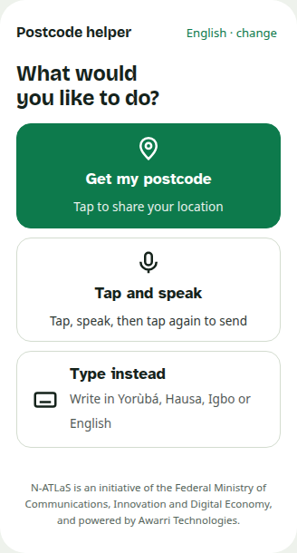 |
| Waiting: finding your building | 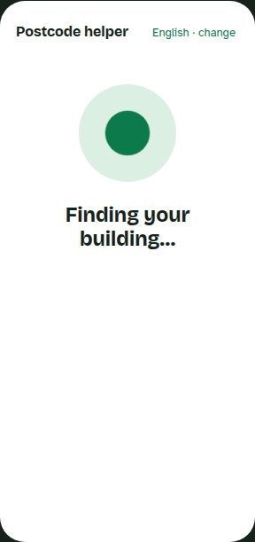 | 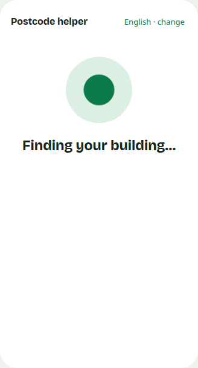 |
| Postcode result | 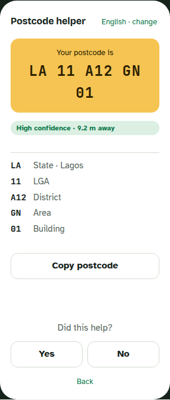 | 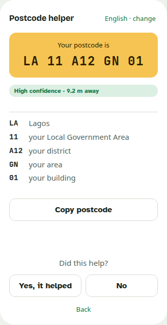 |
| Voice: listening | 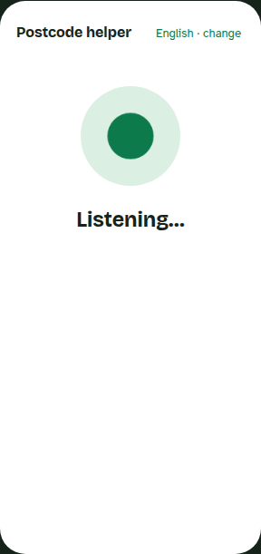 | 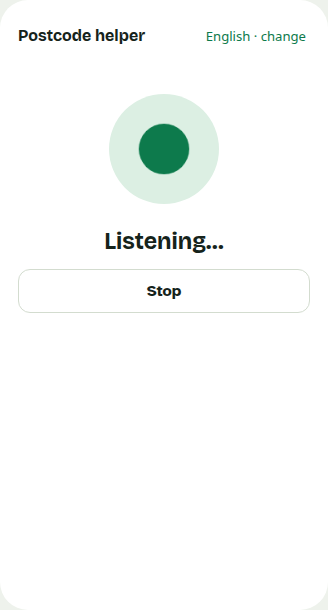 |
| Answer: ask for location (after voice) | 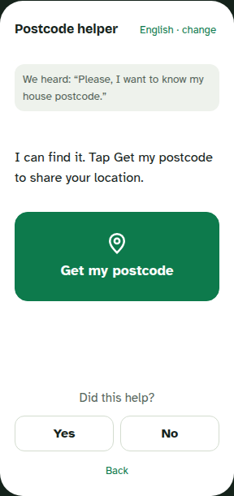 | 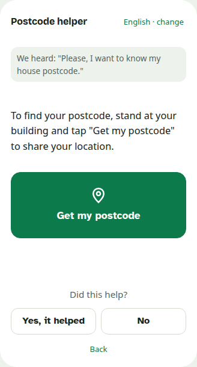 |
| Type instead | 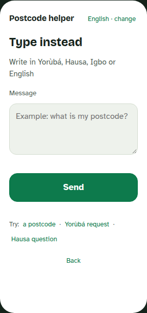 | 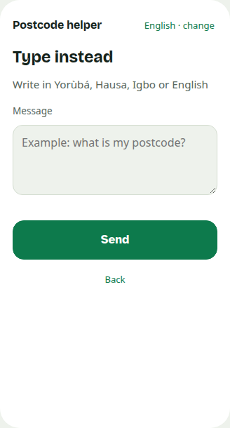 |
| Answer: postcode checked | 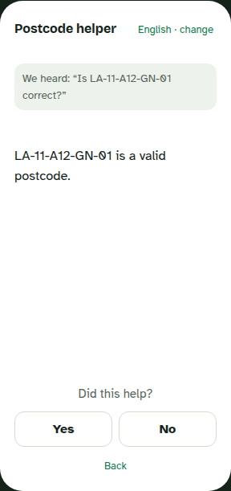 | 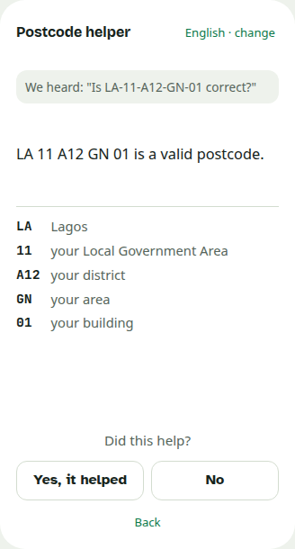 |
| Ask for a code: location button + text box (new) | — | 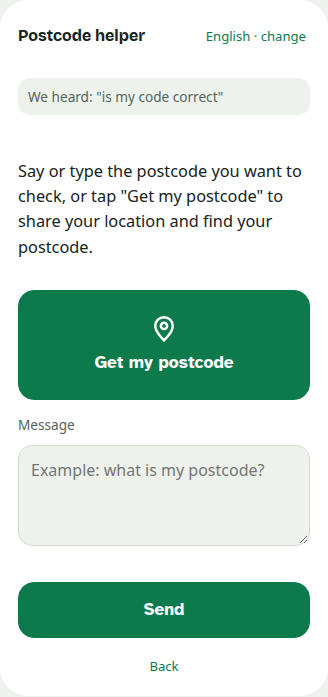 |
| FAQ answer (new: template, no generation) | — | 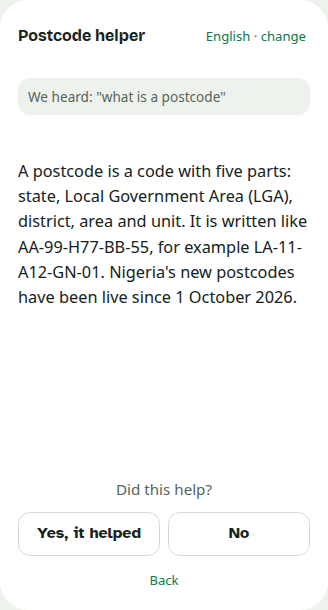 |
| Language screen, Yorùbá browser (glyph check) | — | 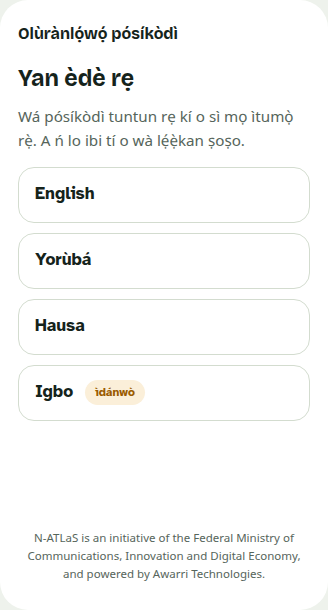 |
| Postcode result in Yorùbá (glyph check) | — | 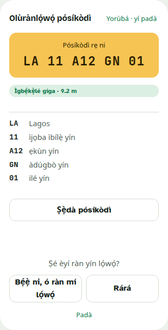 |
| Tab bar + app tab (deployed page, 11 Oct) | 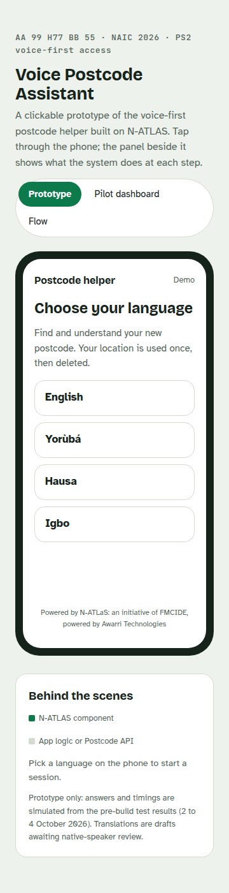 | 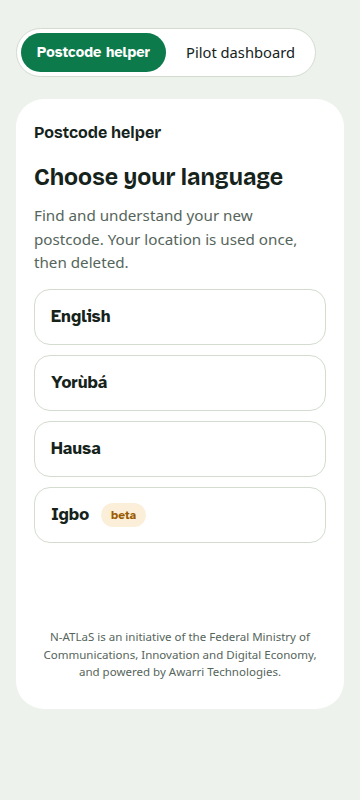 |
| Pilot dashboard tab (deployed page, real data: empty before PILOT_START; prototype shows its example data) | 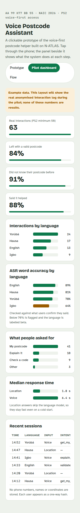 | 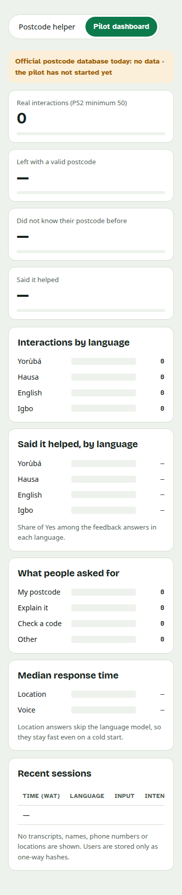 |
